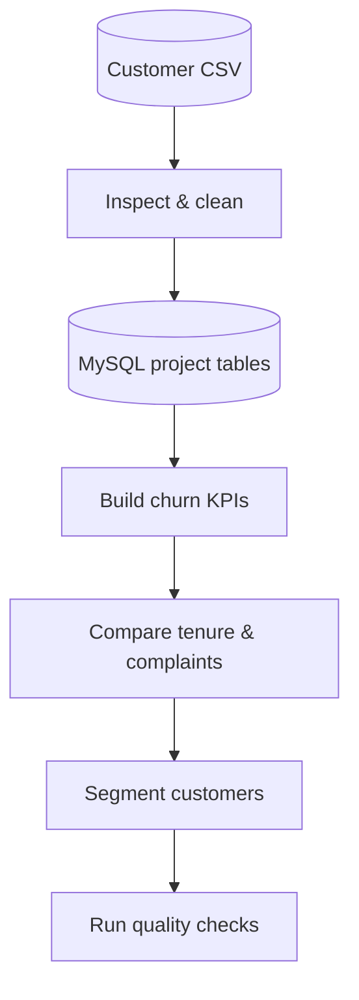

# THE RETENTION INVESTIGATION
### E-commerce customer churn · MySQL

## At a glance

| 
5,628
 | 
4,680
 | 
948
 | 
16.84%
 |
|:---:|:---:|:---:|:---:|
| Cleaned customers | Active | Churned | Churn rate |

## The investigation path

## What the analysis surfaced

| Signal | Active customers | Churned customers |
|---|---:|---:|
| Average tenure | 11.09 | 3.18 |

**53.59%** of churned customers had the complaint flag set in this dataset. This is an association, not proof of cause.

## Choose a workbench

<table>
<tr><th>START HERE</th><th>GO DEEPER</th><th>READ THE METHOD</th></tr>
<tr><td><a href="Ecommerce_Customer_Churn_Analysis.sql">Main SQL script ↗</a> Database and table setup</td><td><a href="analysis/Business_Analysis_Queries.sql">Analysis queries ↗</a> KPIs, segments and checks</td><td><a href="docs/README.md">Documentation index ↗</a> Query-by-query guide</td></tr>
</table>

<strong>Investigation modules</strong>

1. Customer status and churn-rate calculation
2. Tenure and complaint-flag comparison
3. Customer and category segmentation
4. JOIN practice using return examples
5. Duplicate, NULL and outlier checks

> [!CAUTION]
> The main script drops and recreates only `customer_returns` and `customer_churn`. It does not drop the `ecomm` database or unrelated tables. Back up these project tables and use a practice database.

> [!NOTE]
> Eight inserted return/refund rows are illustrative JOIN examples, not verified transactions. Do not use them to calculate a real return rate. WarehouseToHome values 126 and 127 were excluded as extreme observations for this exercise; validate thresholds with business context.

**Scope boundary:** This is descriptive analysis, not a predictive model. It does not prove that tenure or complaints cause churn.