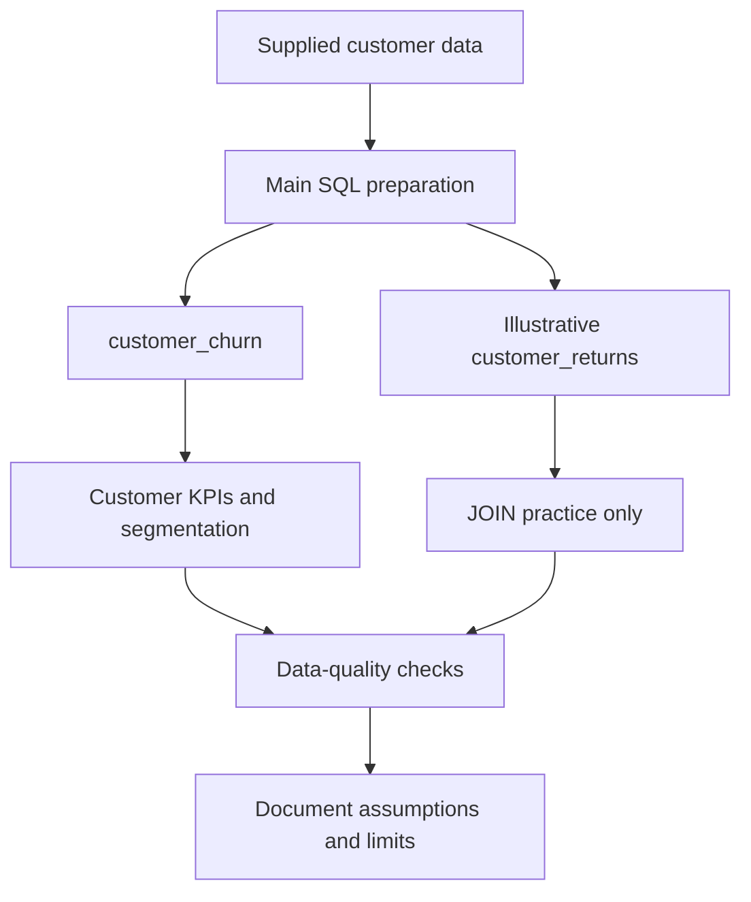

<div align="center">

# CUSTOMER CHURN / SQL INVESTIGATION

**E-COMMERCE RETENTION ANALYSIS**


</div>

## Mission control — dataset scoreboard

|  |  |
|---|---:|
| Source customer rows | **5,630** |
| Rows retained after documented exclusions | **5,628** |
| Active customers | **4,680** |
| Churned customers | **948** |
| **Churn rate** | **16.84%** |

| Segment comparison | Average tenure |
|---|---:|
| Active customers | 11.09 |
| Churned customers | 3.18 |

**Complaint flag:** 53.59% of customers in the churned group are marked as having complained.

<sub>All figures describe the cleaned project dataset. They are not live e-commerce metrics.</sub>

## Investigation map



## Query console — where to start

| File | Role |
|---|---|
| [Ecommerce_Customer_Churn_Analysis.sql](Ecommerce_Customer_Churn_Analysis.sql) | Creates the project database/tables and prepares the analysis dataset |
| [Business_Analysis_Queries.sql](analysis/Business_Analysis_Queries.sql) | 30 queries covering KPIs, behaviour, segmentation, returns/refunds and quality checks |
| [Documentation index](docs/README.md) | Detailed query map and execution notes |

### Query themes

| Workbench | Questions investigated |
|---|---|
| Customer status | How many active and churned records are present? |
| Behaviour | How do tenure, satisfaction, cashback, coupons and complaints compare? |
| Segmentation | How do category, distance and project-defined customer groups differ? |
| Returns | How can a small related table be joined to the customer data? |
| QA checks | Are duplicates, NULLs, unusual values or inconsistent labels present? |

## Observations — not causal claims

- The cleaned dataset records a 16.84% churn rate.
- The churned group has lower average tenure (3.18) than the active group (11.09).
- Complaint flags are more common within the churned group (53.59%).

These are descriptive associations. They do not prove that complaints or tenure cause churn.

## Reproduction steps

```text
1. Open MySQL Workbench (or another MySQL client)
2. Read the destructive-operation warning
3. Use a disposable practice environment
4. Run the main SQL workflow
5. Open analysis/Business_Analysis_Queries.sql
6. Execute and review each query section
```

### SQL reset scope

The main workflow creates database `ecomm` if required and drops/rebuilds only the project tables `customer_returns` and `customer_churn`.

```sql
DROP TABLE IF EXISTS customer_returns;
DROP TABLE IF EXISTS customer_churn;
```

> [!CAUTION]
> A rerun removes existing data in those two project tables. The script does **not** drop the `ecomm` database or unrelated tables. Back up project-table data before rerunning.

## Returns table — training sample only

The workflow inserts **8 illustrative return/refund rows** for JOIN practice. These are not verified transactions and are not a representative sample of returns across all 5,628 customer records. Do not use return-query output to calculate a real business return rate or refund exposure.

## Cleaning decision register

Two `WarehouseToHome` observations above 100 (126 and 127) were excluded as extreme observations for this exercise. This is a project-specific assumption—not a universal rule. Domain context should be checked before using the same threshold in a real business.

## Scope boundary

This is descriptive SQL analysis, not a predictive churn model. Segmentation rules are project-defined, all findings refer to the supplied dataset, and group comparisons do not establish cause and effect.

---

**Author:** Shanmukh Koyya · [GitHub](https://github.com/shanmukhkoyya) · [LinkedIn](https://www.linkedin.com/in/shanmukh-koyya/) · [Email](mailto:shanmukhkoyya123@gmail.com)