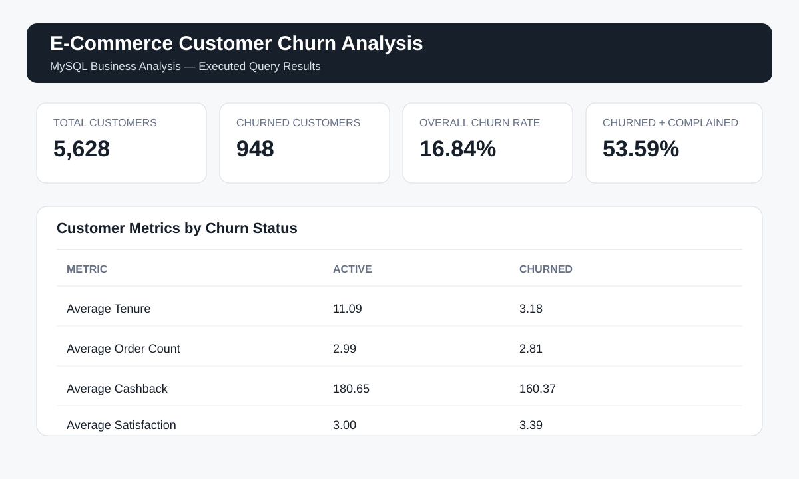

<p align="center">
  
</p>

<h1 align="center">E-commerce Customer Churn Analysis</h1>

<p align="center">
  
  
  
</p>

## 1. Project Overview

Customer churn is an important business challenge for e-commerce companies. Understanding customer behaviour can help businesses identify patterns associated with customer retention and churn.

This project uses SQL and MySQL to clean, transform, analyse and validate an e-commerce customer dataset.

The analysis explores customer churn, complaints, satisfaction, order behaviour, payment preferences, cashback, returns and refunds.

## 2. Business Problem

An e-commerce business wants to understand customer churn and identify customer characteristics associated with churn.

The project uses SQL queries to explore customer behaviour and compare active and churned customer groups.

## 3. Project Objectives

- Clean and prepare raw customer data for analysis.
- Calculate customer counts and the overall churn rate.
- Compare customer behaviour across churn groups.
- Analyse complaints, satisfaction, orders and payment preferences.
- Explore returns and refunds using SQL joins.
- Apply advanced SQL techniques for customer segmentation.
- Validate the cleaned data using data-quality checks.

## 4. Dataset Overview

The project uses a supplied e-commerce customer dataset.

| Dataset measure | Result |
|---|---:|
| Source records | 5,630 |
| Records after cleaning | 5,628 |
| Active customers | 4,680 |
| Churned customers | 948 |

The dataset includes customer information such as tenure, order count, satisfaction score, preferred payment mode, complaints, cashback, returns and churn status.

## 5. SQL Workflow

The project is organised into two SQL files.

### Step 1 — Database Setup and Data Preparation

**File:** `Ecommerce_Customer_Churn_Analysis.sql`

- Set up the database and tables.
- Review and clean selected fields.
- Handle missing values and inconsistent categories.
- Prepare analysis-ready customer fields.
- Create the cleaned customer and returns tables.

### Step 2 — Business Analysis

**File:** `analysis/Business_Analysis_Queries.sql`

Contains 30 SQL queries organised into:

1. Core business KPIs
2. Customer behaviour and experience
3. Customer segmentation and advanced SQL
4. Returns and refunds
5. Data-quality validation
6. Interview-level SQL skills

## 6. Key Business Findings

The following results are documented from the cleaned project dataset.

| KPI | Result |
|---|---:|
| Total customers | 5,628 |
| Active customers | 4,680 |
| Churned customers | 948 |
| Overall churn rate | 16.84% |
| Churned customers who complained | 53.59% |
| Average tenure — active customers | 11.09 |
| Average tenure — churned customers | 3.18 |

### Observations

- The cleaned dataset contains 5,628 customer records.
- The calculated churn rate is 16.84%.
- Churned customers have a lower average tenure than active customers in this dataset.
- Complaints are present among a substantial share of churned customers.

These are descriptive observations from the supplied dataset. They do not establish that complaints or tenure cause churn.

## 7. Analysis Summary



*Static summary graphic based on the documented project results.*

## 8. SQL Skills Demonstrated

| Level | SQL techniques |
|---|---|
| Beginner | SELECT, WHERE, ORDER BY, DISTINCT |
| Intermediate | GROUP BY, HAVING, CASE, aggregate functions |
| Advanced | Joins, subqueries, conditional aggregation, window functions |
| Data Quality | Duplicate checks, NULL checks, label validation, outlier checks |

## 9. Data Quality Validation

The project includes SQL checks for:

- Duplicate customer IDs.
- Missing values in key analytical fields.
- Remaining distance outliers.
- Standardised churn and complaint labels.
- Standardised payment modes.
- Final cleaned customer record count.

## 10. Project Structure

```text
ecommerce-customer-churn-analysis/
│
├── Ecommerce_Customer_Churn_Analysis.sql
│
├── analysis/
│   └── Business_Analysis_Queries.sql
│
├── images/
│   └── sql-analysis-summary.svg
│
└── README.md
```

## 11. How to Run the Project

**Prerequisite:** MySQL Server and MySQL Workbench.

1. Clone or download this repository.
2. Open `Ecommerce_Customer_Churn_Analysis.sql` in MySQL Workbench.
3. Execute the main SQL workflow from the beginning.
4. Confirm that the required tables have been created.
5. Open `analysis/Business_Analysis_Queries.sql`.
6. Execute the business analysis queries section by section.
7. Review the results and data-quality validation outputs.

**Important:** Run the main SQL file before running the business analysis file because the second file depends on the tables created by the first.

## 12. Scope and Limitations

- Results depend on the supplied project dataset and cleaning choices.
- Distance bands and order-count segments are project-specific analytical rules.
- Group comparisons are descriptive and do not establish cause and effect.
- This is a SQL-based descriptive analysis, not a predictive machine-learning churn model.
- The calculated churn rate should not be interpreted as a real company's current churn rate.

## 13. Author

**Shanmukh Koyya**

- **GitHub:** [shanmukhkoyya](https://github.com/shanmukhkoyya)
- **LinkedIn:** [linkedin.com/in/shanmukh-koyya](https://www.linkedin.com/in/shanmukh-koyya/)
- **Email:** [shanmukhkoyya1234@gmail.com](mailto:shanmukhkoyya1234@gmail.com)
