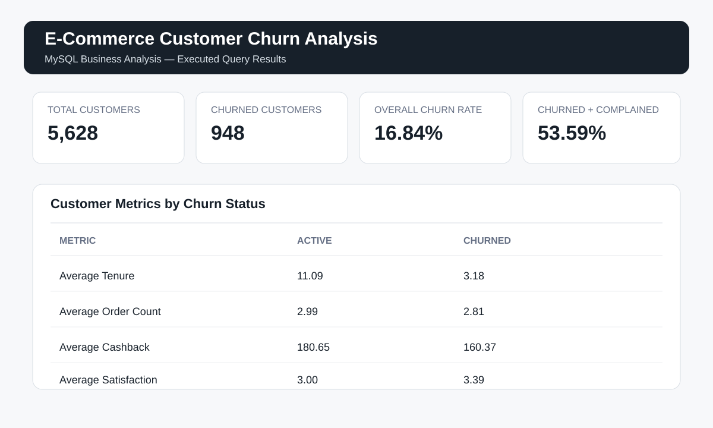

# E-commerce Customer Churn | SQL Analysis Playbook

**CUSTOMER RETENTION · BEHAVIOUR · DATA QUALITY**

MySQL · Relational Queries · Descriptive Analysis

## Why this analysis?

The project explores how customer churn is represented in a supplied e-commerce dataset. SQL is used to prepare the records, create analysis-ready fields, compare customer groups, and validate selected data-quality conditions.

## Dataset scoreboard

| Measure | Result |
|---|---:|
| Source customer records | 5,630 |
| Records retained after documented cleaning | 5,628 |
| Active customers | 4,680 |
| Churned customers | 948 |
| Churn rate | 16.84% |
| Average tenure — active group | 11.09 |
| Average tenure — churned group | 3.18 |
| Churned customers who complained | 53.59% |

These values describe the cleaned project dataset only.

## Query workflow

| File | Role |
|---|---|
| [Main SQL workflow](Ecommerce_Customer_Churn_Analysis.sql) | Creates the project tables, prepares customer fields and creates the sample returns table |
| [Business Analysis Queries](analysis/Business_Analysis_Queries.sql) | 30 queries across KPIs, behaviour, segmentation, returns/refunds and data-quality validation |
| [Documentation index](docs/README.md) | Query sections, execution notes and limitations |

### Analysis themes

**Customer status** — total customers, churned customers and churn-rate calculations.

**Customer behaviour** — tenure, order count, satisfaction, cashback, payment preferences, coupons and complaints.

**Segmentation** — category and distance groups, conditional logic, ranking and subqueries.

**Returns and refunds** — JOIN practice using the small illustrative returns table.

**Data quality** — duplicate, NULL, outlier and label checks.

## What stands out in this dataset?

- The cleaned data has a churn rate of 16.84%.
- Average tenure is lower for the churned group (3.18) than for the active group (11.09).
- 53.59% of churned customers are marked as having complained.

These are associations observed in the supplied data. They do not prove that complaints or tenure cause churn.

Static summary graphic based on the documented project results.

## Data preparation decisions

The project documents missing-value handling and standardisation for the supplied fields. Two records with WarehouseToHome values above 100 were excluded as extreme observations for this exercise. That is a project-specific choice, not a universal business rule; it should be reviewed against domain context before real-world use.

## Important: execution safety

> [!CAUTION]
> The main SQL file is not read-only. It creates the ecomm database if needed, then drops and rebuilds only the customer_returns and customer_churn project tables. Existing data in those two tables will be lost on a full rerun. The script does not drop the ecomm database or unrelated tables. Back up any project-table data you need before execution.

## Returns table: sample data only

The SQL workflow inserts **8 illustrative return/refund records** for JOIN practice. They are not verified business transactions and are not a representative sample of returns across all 5,628 customer records. Outputs from return-related queries must not be used to estimate a real business return rate or refund exposure.

## Reproduce the work

1. Use MySQL Server and MySQL Workbench or a compatible MySQL client.
2. Read the execution-safety warning above.
3. Run the main SQL workflow first in a disposable practice environment.
4. Open the business analysis file and execute queries section by section.
5. Review result sets and the final data-quality queries.

## Skills demonstrated

SELECT · WHERE · GROUP BY · HAVING · CASE · aggregate functions · joins · subqueries · conditional aggregation · window functions · NULL/duplicate checks

## Project boundaries

This is descriptive SQL analysis, not a predictive machine-learning churn model. Segments use project-defined rules, findings refer only to the supplied data, and group comparisons do not establish cause and effect.

---

**Shanmukh Koyya** · [GitHub](https://github.com/shanmukhkoyya) · [LinkedIn](https://www.linkedin.com/in/shanmukh-koyya/) · [Email](mailto:shanmukhkoyya1234@gmail.com)
