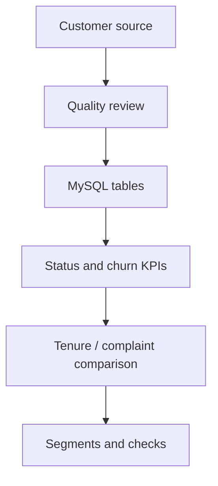

<h1>RETENTION CONTROL ROOM</h1>

MYSQL · E-COMMERCE CUSTOMER CHURN

## Dataset pulse
<table><tr><td align="center"><h1>5,628</h1>cleaned customers</td><td align="center"><h1>4,680</h1>active</td><td align="center"><h1>948</h1>churned</td><td align="center"><h1>16.84%</h1>churn rate</td></tr></table>

## Investigation pipeline

## Signal board
| Observed pattern | Active | Churned |
|---|---:|---:|
| Average tenure | 11.09 | 3.18 |

**Complaint flag:** 53.59% of churned customers had the flag set in this dataset. This is an association, not evidence that complaints caused churn.

## Business recommendations

The dataset shows a 16.84% churn rate and lower average tenure in the churned group (3.18) than in the active group (11.09). The complaint flag appears in 53.59% of churned records. These are descriptive patterns, so the following are **actions to test**, not proven causes or guaranteed results.

1. **Test an early-tenure retention journey.** Break customers into tenure cohorts, review when churn is concentrated, then pilot a welcome or follow-up programme for newer customers. Compare retention with a suitable baseline or holdout group before scaling it.
2. **Review complaint resolution.** Inspect complaint type, timing, resolution status and repeat contacts for the flagged records. Test whether clearer ownership or faster follow-up improves customer outcomes; do not assume the flag itself caused churn.
3. **Build a retention monitoring view.** Track churn rate, tenure bands, complaint status and cohort retention together. Keep segment definitions consistent and validate record counts before using the measures in operating reviews.

**Decision boundary:** this project does not identify causal drivers or predict which individual customer will leave. Validate these ideas with current, representative customer and service data before making retention-policy or budget decisions.

## Open the SQL workbench
- [Main SQL setup](Ecommerce_Customer_Churn_Analysis.sql)
- [Analysis queries](analysis/Business_Analysis_Queries.sql)
- [Documentation index](docs/README.md)

## Safety & interpretation
> [!CAUTION]
> The main script drops and recreates only `customer_returns` and `customer_churn`. It does not drop the `ecomm` database or unrelated tables. Back up the two project tables and use a practice database.

> [!NOTE]
> Eight return/refund rows are illustrative JOIN examples, not verified transactions. Do not calculate a real return rate from them. WarehouseToHome values 126 and 127 were excluded as extreme observations for this exercise.

**Boundary:** descriptive SQL analysis only; not a predictive model and not proof of cause.